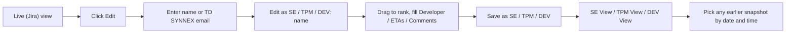
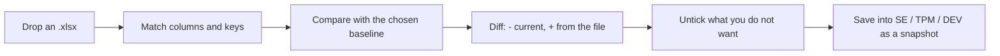
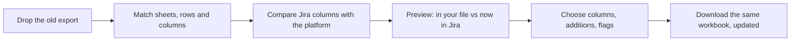

# Backlog Report Platform

A centralized web platform for SE, TPM, and DEV stakeholders to view, prioritize, and collaborate on Jira backlog reports — built on top of the existing **`jira-rel-review`** skill.

---

## Solution

A shared web application where:

- **Jira is the source of truth for status** (backlog status, NDP status, release status, hours).
- **The platform is the source of truth for collaboration** (rank/priority, comments, UAT ETA, PROD ETA, Developer assignment).
- Anyone with permission can click **"Update from Jira"** to refresh status fields while preserving user-edited fields.
- All stakeholders see the same live view — no more emailing Excel files.

```
┌─────────────┐     "Update"      ┌──────────────────┐     jira-rel-review     ┌──────┐
│  Web UI     │ ────────────────► │  Backend API     │ ──────────────────────► │ Jira │
│  drag/drop  │ ◄──────────────── │  + database      │ ◄────────────────────── │      │
│  comments   │   merged view     └──────────────────┘                         └──────┘
└─────────────┘
```

---

## Existing Skill (Foundation)

The platform wraps the existing Python skill at `jira-rel-review/`:

| Script | Purpose |
|--------|---------|
| `update_latest_reports.py` | Entry point — refreshes all three quarter reports |
| `export_regions.py` | Fetches Jira data, classifies NA/LAC, builds workbook |
| `export_hierarchy.py` | Jira API helpers, tree builder, field resolution |
| `regions.config.json` | Region JQL, domain filters, quarter config |

### Current report layout (Excel, to be replaced by web UI)

```
Report/
  AR_GL/AR_GL_Summary_<quarter>.xlsx   ← comprehensive (NA + LAC, AR + GL)
  AR/AR_Summary_<quarter>.xlsx          ← AR only
  GL/GL_Summary_<quarter>.xlsx          ← GL only
```

Each workbook contains:
- `summary` sheet with **Last Updated** timestamp
- Mapping sheets: `NA_AR`, `NA_GL`, `LAC_AR`, `LAC_GL`, etc.
- Tree sheets: `NA_GL_tree`, etc. (RELEASE → NDP → Backlog hierarchy)

### Mapping sheet columns (current)

```
Release | Release Title | NDP | NDP Status | NDP Deploy Date |
Backlog Key | Summary | Issue Type | Status | Assignee | Developer |
Reporter | Priority | Biz Domain | Req Qtr | Labels | Backlog Source |
Est h | Spent h | UAT ETA | PROD ETA | Comments
```

**Jira-sourced** (overwritten on every refresh): Status, NDP, NDP Status, NDP Deploy Date, Est h, Spent h, Assignee, etc.

**User-editable** (preserved on refresh): Developer, UAT ETA, PROD ETA, Comments, **Rank** (new in platform).

### Region classification rules (backend must enforce)

| Region | Rule |
|--------|------|
| **NA** | Key starts with `CISGL`, `CISAR`, or `CIS` (CISGL/CISAR always NA, even if LAC-labelled) |
| **LAC** | Key starts with `MCAM`, `WMCC`, or has label token `LAC` |
| **Exclude** | Key starts with `KSPE`, or label contains `gl-killsp` |

Fetch from both NA and LAC JQL, merge, dedupe, then route each backlog to the correct region sheet. Never duplicate across NA/LAC.

### Jira credentials

```
JIRA_URL=https://jira.synnex.com
JIRA_PAT=<personal access token>
```

Stored in `.env` at workspace root. PAT must live on the server only — never exposed to the browser.

---

## Status: built and running

The platform runs locally today: FastAPI + SQLite behind a React + Vite UI, pulling live
Jira data through the `jira-rel-review` skill. Start with [Running it](#running-it), then
[Editing workflow](#editing-workflow-roles-and-snapshots).

---

## MVP Scope (Phase 1)

### Features

1. **Report views** — AR_GL, AR, GL for configured quarter (default `2026Q3`)
2. **Flat backlog table** — sortable, searchable grid per region/domain sheet, with a
   dropdown to view one backlog status at a time
3. **Tree view** — RELEASE → NDP → Backlog collapsible hierarchy
4. **"Update from Jira" button** — runs the skill server-side as a background job with a
   duration estimate; only ever refreshes Jira columns
5. **Drag-and-drop ranking** — per sheet, inside a snapshot
6. **Inline editing** — Developer, UAT ETA, PROD ETA, Comments
7. **Groups** — System Engineer, TPM, Developer; membership decides the Save button, and
   changing membership needs the admin passphrase
8. **Role snapshots** — SE / TPM / DEV views, each with full save history by date and time
9. **Audit log** — who changed which field, from what to what, in which snapshot
10. **Excel export** — the visible view, styled like the skill's workbooks
11. **Spreadsheet analyzer** — upload a circulated Excel copy, diff it against the live
    report or any role view, save the parts you keep into the SE, TPM, or DEV view, and
    get your own workbook back with the same outcome written into it
12. **Spreadsheet updater** — upload an old exported report and get it back with the
    Jira columns brought forward, every edit and highlight left as it was

### Refresh rules

```
For each backlog key in the report:
  IF key exists in Jira response:
    overwrite  → Status, NDP, NDP Status, NDP Deploy Date, Est h, Spent h,
                  Assignee, Summary, Priority, Release, Release Title, etc.
  IF key is new in Jira (not in DB):
    insert
  IF key missing from Jira twice in a row:
    mark as archived / show stale badge

Snapshots are never read or written by a refresh, so user values cannot be lost.
```

### Out of scope for MVP (Phase 2)

- Custom columns per team
- Manual rows (backlogs not yet in Jira)
- Push notifications on NDP status change
- Multi-quarter comparison

---

## Tech Stack (as built)

| Layer | Technology | Rationale |
|-------|-----------|-----------|
| **Backend** | Python FastAPI | Reuses the existing `jira-rel-review` Python scripts directly |
| **Database** | SQLite via SQLAlchemy | Local file; Postgres is a connection-string change |
| **Frontend** | React + TanStack Table v9 + `@dnd-kit` | Spreadsheet-like grid with drag-and-drop |
| **Identity** | Name/email checked against group lists | No passwords; enough to attribute a save |
| **Hosting** | Your machine | Jira PAT stays server-side |

---

## Data Model (as built)

```
Report
  kind (AR_GL | AR | GL), quarter, last_jira_sync_at, last_sync_status, last_sync_error

BacklogSnapshot            -- Jira-owned, rewritten every sync, no user input
  report_kind, quarter, sheet, region, domain
  key                      -- e.g. CISGL-2412 (unique per report + sheet)
  release, release_title, ndp, ndp_status, ndp_deploy_date, summary, issue_type,
  status, assignee, reporter, priority, biz_domain, req_qtr, labels,
  backlog_source, est_h, spent_h
  archived, missing_streak, last_seen_at

User
  email (unique), name, role (SE | TPM | DEV | ADMIN)

ReportSnapshot             -- one save by one person
  report_kind, quarter, role, author_email, author_name, label,
  based_on_id, created_at

SnapshotRow                -- user values inside that save
  snapshot_id, sheet, key, rank, developer, uat_eta, prod_eta, comments

AuditLog
  actor, role, snapshot_id, quarter, report_kind, sheet,
  backlog_key, field, old_value, new_value, changed_at

SyncJob
  quarter, report_kind, state (running | done | failed), message,
  started_at, finished_at
```

---

## API Endpoints

```
GET    /api/reports                            List reports for a quarter
GET    /api/quarters                           Quarters present in the database
POST   /api/quarters                           Open an empty quarter, e.g. 2026Q4
DELETE /api/quarters/:quarter                  Take an untouched quarter back off the list
GET    /api/reports/:kind/:quarter             Live view; add ?role= or ?snapshot_id=
GET    /api/reports/:kind/:quarter/tree        RELEASE -> NDP -> Backlog hierarchy
GET    /api/reports/:kind/:quarter/export      Download the view as .xlsx (?sheet=, ?status=)
POST   /api/reports/:kind/:quarter/refresh     Start a Jira sync (kind=ALL for all three)
GET    /api/sync/status?kind=GL                Job state, elapsed, and duration estimate

POST   /api/reports/:kind/:quarter/analyze              Upload an .xlsx, get a diff preview
                                                        (compare_with=LIVE|SE|TPM|DEV)
POST   /api/reports/:kind/:quarter/analyze/apply        Save the accepted changes as a snapshot
POST   /api/reports/:kind/:quarter/analyze/file-preview   What the upload itself would become
POST   /api/reports/:kind/:quarter/analyze/file-download  The upload, with the outcome in it
POST   /api/reports/:kind/:quarter/refresh-file         What a stale workbook would gain
POST   /api/reports/:kind/:quarter/refresh-file/download  The same workbook, brought up to date

GET    /api/reports/:kind/:quarter/snapshots   Saves, optionally ?role=SE
POST   /api/reports/:kind/:quarter/snapshots   Save the current table as the author's role
GET    /api/snapshots/:id                      One snapshot's metadata
DELETE /api/snapshots/:id                      Remove a snapshot

GET    /api/users                              Group membership (open to everyone)
GET    /api/users/admin                        Is a passphrase set, and is this one right
POST   /api/users                              Add or move someone (needs X-Admin-Key)
DELETE /api/users/:id                          Remove from groups (needs X-Admin-Key)
POST   /api/users/identify                     Resolve a name or email to a role

GET    /api/audit?backlog_id=:id               Change history for one backlog
```

---

## Frontend Pages

| Page | Description |
|------|-------------|
| `/reports` | Report picker: AR_GL / AR / GL |
| `/reports/:kind/:quarter` | Main view: region tabs on top, then search, views, and update |
| `/reports/:kind/:quarter/tree` | Read-only RELEASE → NDP → Backlog tracker, filtered by NDP status |
| `/reports/:kind/:quarter/analyze` | Upload a spreadsheet, review the diff, save it into a role view |
| `/reports/:kind/:quarter/update-file` | Upload a stale spreadsheet, download it up to date |
| `/admin/users` | Group membership for System Engineer / TPM / Developer |

### Main view layout

```
NA_AR | NA_GL | NA_AR+GL | LAC_AR | LAC_GL | LAC_AR+GL      <- region tabs
[ search ] [ Edit ]           Live | SE View | TPM View | DEV View   [ Update from Jira ]
                              Snapshot: 08/06/2026 06:15 PM ...      Last updated: ...
[ All statuses (95) v ]           [ Export to Excel (all tabs) ] [ This tab only ]
```

The status dropdown narrows the table to one backlog status. Each entry carries its count
for the region sheet you are on, ordered by the number in the status name, so the row
count is part of the control rather than a separate label. The choice narrows the export
too, so a download matches what is on screen. Reordering is suspended while a single
status is selected, because ranking is decided across the whole sheet.

### Main table interactions

- Read-only until you click Edit and are matched to a group
- Drag the handle to reorder, or type a number straight into the Rank cell; repeated
  numbers are allowed, and ties fall back to release, NDP, then key order
- Changed cells are highlighted until saved
- Click a cell to edit Developer / UAT ETA / PROD ETA / Comments
- Click a backlog key for its change history
- Search box and status dropdown filter the current sheet; searching, sorting, or picking
  a single status suspends reordering
- **Export to Excel (all tabs)** is the default: every region sheet of the report in one
  workbook, one tab each, in saved order, with the user columns from the selected
  snapshot, NDP status cells colored with the skill's palette, and an `about` tab
  recording the source. Share this, and feed this to the Analyzer and the Updater, which
  can only cover the tabs a file actually contains
- **This tab only** narrows the same download to the region sheet on screen

### Tree page

The tree is a status tracker only, so it has no role views and nothing is editable there.
It always shows live Jira data. Above the tree sit status tabs — All statuses, Open, N/A,
IT Leader Approved, IIC Approved, QC Approved, Verified, and whatever else Jira returns —
so you can look at one status at a time or all of them together. Counts follow the region
sheet you are on.
- NDP status color-coded with the skill's palette (QC Approved red, IIC yellow, and so on)

---

## Project Structure

```
backlog_manager/
  backend/
    app/
      main.py              FastAPI entry + CORS
      config.py            paths, report specs, default quarter
      db.py                SQLAlchemy engine/session
      models.py            Report, BacklogSnapshot, User, ReportSnapshot, SnapshotRow, AuditLog, SyncJob
      schemas.py           Pydantic response models
      routers/             reports.py, snapshots.py, users.py, audit.py, analyzer.py
      services/
        jira_sync.py       calls the skill, stabilizes search, flattens to rows
        merge.py           writes Jira rows only; never touches snapshots
        excel_export.py    builds the .xlsx download
        spreadsheet_layout.py    finds the header row, key column and fields in any copy
        spreadsheet_analyzer.py  file -> platform: diffs an upload against a view
        spreadsheet_updater.py   platform -> file: rewrites a stale file's Jira columns
    .env                   ADMIN_KEY, never committed
    verify_parity.py       counts vs Excel + internal invariants
    test_snapshots.py      groups, identity, and snapshots surviving a refresh
    test_analyzer.py       analyzer parsing and diff rules, no server needed
    test_analyzer_api.py   export -> renamed copy -> preview -> partial apply
    test_updater.py        refresh keeps edits, ranks and highlighting, no server needed
    test_updater_api.py    export -> aged copy -> refreshed download
    test_quarters.py       opening, using and removing a quarter
    db_info.py             where the database is and what is in it
    requirements.txt
  scripts/
    setup.ps1              installs dependencies, builds the UI, creates backend/.env
    start.ps1              runs UI + API together on one port
  frontend/
    src/
      pages/               ReportsPage, ReportPage, TreePage, AnalyzerPage, UpdaterPage, UsersPage
      components/          BacklogTable, EditableCell, IdentityPrompt, UpdateButton, AuditDrawer
      api.ts, types.ts, useSync.ts, ndp.ts, styles.css
    package.json
  .cursor/skills/jira-rel-review/   the skill (Cursor loads it, backend imports it)
  README.md
  .env.example
```

---

## Editing workflow (roles and snapshots)

The live table is always the untouched Jira pull. Edits never change it; they are saved
as **snapshots** owned by the editor's group, so SE, TPM, and DEV each keep their own
history of the same backlog.



1. **Groups first.** Open **Users** in the top nav and add each person's TD SYNNEX email
   to System Engineer, TPM, or Developer. Nobody can edit until they are in a group.
   Everyone can read the group list, but adding and removing members requires clicking
   **Unlock admin** and entering the passphrase from `backend/.env` (see below). The
   passphrase is held in memory only, so closing the tab locks it again.
2. **Edit.** The Edit button sits under the search bar. It asks
   `Please enter your name or TD SYNNEX email address:`, matches the entry against the
   groups, and confirms with `Edit as SE: <name>` before unlocking the table. An
   unrecognized entry is refused with a message pointing at the Users page.
3. **Change.** While editing, the drag handle reorders rows and the Developer, UAT ETA,
   PROD ETA, and Comments cells accept input. Changed cells are highlighted and counted;
   nothing is written to the server yet.
4. **Save.** The button reads `Save as SE`, `Save as TPM`, or `Save as DEV` according to
   the editor's group. Saving writes one snapshot and one audit row per changed field.
5. **Review.** The view tabs sit to the right of the search bar: Live (Jira), SE View,
   TPM View, DEV View. Each role view has a snapshot picker listing every save by date,
   time, and author, so any earlier state can be traced back.

Jira columns always show current data even inside a role view; only the user columns and
the row order come from the snapshot. That means a snapshot cannot go stale on status.

Ranking is per sheet, so `NA_GL` is ordered independently from `LAC_GL`. The live view
keeps its own text columns empty but still shows the ranking from the most recent save of
any role, so priority order is never lost. Where nothing has been ranked yet, rows are
numbered by their position in Jira order rather than shown as zero.

## Opening a new quarter

Backlogs roll over every quarter, so the quarter list is not fixed. The dropdown on the
Reports page ends with **+ Add quarter...**, which opens a box already filled in with the
quarter after the one on screen — `2026Q3` suggests `2026Q4`, `2026Q4` suggests `2027Q1`.

The new quarter appears immediately with the same three reports, **all empty**, and stays
that way until someone presses **Update from Jira**. That sync puts the quarter name
straight into the skill's JQL, so `2026Q4` fetches `"Request Qtr" ~ 2026Q4` for NA and
`labels = 2026Q4` for LAC, and the rows it stores are that quarter's.

The name is validated as four digits, `Q`, then `1`-`4`, because it is substituted into the
query verbatim and a typo would otherwise sync an empty report with no explanation.
Lower case and stray spaces are accepted and normalized. A quarter that is still empty can
be taken back off the list with the **Remove** button next to the dropdown, which is the way
out of a mistyped name; once it holds backlogs or saves, that button refuses.

## Importing a spreadsheet someone sent back

Copies of the report still circulate by email, and they come back with other people's
ranking, comments, developer names, and ETAs in them. **Analyzer** in the top nav (or
**Import spreadsheet** next to Edit) takes one of those files, works out what it is
saying, and shows the difference before anything is written.



1. **Identify.** Same check as editing: only System Engineer, TPM, and Developer members
   can import, and the endpoints refuse anyone else rather than relying on the UI.
2. **Choose what to compare against.** These are two separate decisions:

   | Baseline | What the diff means |
   |----------|---------------------|
   | **Latest backlog report** | The live Jira pull with no snapshot over it. Everything the file fills in reads as incoming — use this to see the whole of what a copy is carrying |
   | **SE / TPM / DEV View** | That group's most recent save. Use this to see only what the copy adds on top of what the group already agreed |

   Comparing against one view and saving into another is allowed: measure a file against
   the live report, then land it in TPM View. Whichever view you save into, the snapshot
   is still built on that view's own latest save, so its other rows are never lost.
3. **Drop the file.** `.xlsx` or `.xlsm`, up to 25 MB. An `.xls` is refused with a note to
   re-save it.
4. **Read the diff.** A commit-style view, one card per backlog: the key, its sheet,
   status and summary, then each field as a red `−` line for what the baseline holds and
   a green `+` line for what the file says, tagged `added` or `changed`. Tick boxes sit on
   every line and on the card, so a whole backlog or a single cell can be dropped.
   Alongside it: a stat bar (`+n added  ~n changed  n identical  n not in the report`),
   column filters with counts, and an **Already identical** tab listing the rows the file
   speaks about that the baseline already agrees with — so an empty diff is visibly a
   result rather than a failure.
5. **Preview your own file.** **Preview updated spreadsheet** shows what the workbook you
   uploaded would become, cell by cell and grouped by tab, without writing anything. Its
   Rank, Developer, UAT ETA, PROD ETA and Comments are set to what the target view will
   hold once the import lands — the changes you kept, plus anything that view already had
   which your copy was missing; a change you dropped reverts to the view's value. Jira
   columns and every other cell are left alone, and no rows are added or removed.
6. **Apply and export.** One button does both halves: the accepted lines are written as a
   new snapshot of the target view — authored by whoever uploaded, labelled with the file
   name, one audit row per applied cell — and the same outcome is written into your
   workbook, which downloads immediately. Your copy and the shared view cannot drift
   apart, because both come from the same merged rows.

The analyzer only ever imports the columns people type into. If the upload's Jira columns
have gone stale as well, the summary says how many cells and links to the Updater below,
which is the tool for writing Jira data back into a file.

### What the analyzer works out for itself

| Situation | Behavior |
|-----------|----------|
| Columns renamed (`Dev Owner`, `Remarks`, `Go-Live`, `#`) | Matched by alias, ignoring case, spaces and punctuation |
| Title rows or notes pasted above the table | The header row is the one that matches the most known columns, searched over the first 15 rows |
| No column named for the key | A column whose values look like `CISGL-2412` is used instead |
| Several region tabs in one workbook | Every tab is read and reported separately: `NA_GL: 108/108 rows → NA_GL`. A file holding one tab is compared on that tab only, and the preview says so |
| `about`, `summary`, and `_tree` worksheets | Skipped, and listed as skipped, so tree sheets cannot double-count |
| Backlogs that are not in this report | Reported as unmatched and left out, never inserted |
| Empty cells | Ignored. An upload can add or change a value but never clears one |
| Only the spacing or casing differs | Counted as identical, not offered as a change |
| Real dates, or numbers stored as floats | Normalized to `YYYY-MM-DD` and whole numbers before comparing |
| Worksheet named after a region sheet | Its rows are pinned to that sheet, ranking included |
| A key that lives in `NA_AR` **and** `NA_AR+GL` | Text goes to both; ranking is held back with a warning, because rank only means something inside one sheet |

Jira-owned columns in the file — status, NDP, hours, assignee — are read past and never
compared. Jira stays the source of truth for those, so an old copy cannot roll them back.

## Bringing an old spreadsheet up to date

The analyzer above pulls a file's edits **into** the platform. This does the opposite,
for the case where the file is what everyone is working in and it is the file that has
gone stale.

> A report was exported and shared a week ago. Since then the TPM and the stakeholders
> have ranked it, commented on it and highlighted rows — but Jira has moved on too.
> Statuses advanced, an NDP was approved, `CISGL-2556` was raised and did not exist when
> the file was made, and one backlog was dropped. The spreadsheet everyone is working in
> is now wrong about Jira and right about everything else.

**Updater** in the top nav (or **Update spreadsheet** next to Edit) takes that file and
gives it back with only the Jira columns rewritten.



| What it does | Detail |
|--------------|--------|
| **Refreshes Jira columns** | Status, NDP, NDP Status, NDP Deploy Date, Release, Summary, Assignee, Est h, Spent h and the rest. Tick only the columns you want; every one is listed with the number of cells behind it |
| **Adds what was raised since** | Backlogs the platform has and the file does not are appended at the bottom of their sheet, styled like the rows above them, with the user columns left empty |
| **Flags what Jira dropped** | Rows the report no longer returns, or that went archived, are kept exactly as they are and marked in an `Update Status` column — nothing is ever deleted, because people's comments live on those rows |
| **Leaves your work alone** | Rank, Developer, UAT ETA, PROD ETA, Comments are never written. Fills, fonts, column widths, formulas, merged cells and conditional formatting survive the round trip |
| **Sections the preview by tab** | Changes are grouped under the worksheet they came from — `NA_GL`, `LAC_GL`, and for AR_GL all six — never interleaved into one flat list. Each section counts its cells and its status moves |
| **Tags what kind of change it is** | Backlogs the file has never seen are tagged **New** in green, on a green panel. Movement in Status or NDP Status is tagged **Status Update** in the same amber as *IT Exec Approved*. Rows Jira stopped returning are tagged **Removed** |
| **Records what it did** | An `update log` sheet lists every cell it changed, was → now, plus the counts and the Jira timestamp behind them |
| **Colors NDP status** | A refreshed NDP Status cell is refilled with the skill's palette, so an approval is visible at a glance |
| **Re-stamps the timestamp** | An `about` or `summary` sheet claiming an old "Jira last updated" is corrected |

The comparison ignores cosmetic differences — whitespace, casing, `8` against `8.0`, a
real date against a typed one — so the preview only lists cells that genuinely disagree.
Running the updater on a file it has already refreshed finds nothing left to do.

**Two things to know.** The Jira data used is whatever the last sync pulled, so press
**Update from Jira** on the table first if that timestamp looks old; the preview shows it.
And openpyxl rewrites the workbook, which preserves everything above but drops embedded
charts and images — keep those in a separate file.

## Resolved questions

| # | Question | Decision |
|---|----------|----------|
| 1 | Hosting | Runs as one process on a laptop today; the same build can be hosted internally later. |
| 2 | Auth | No login. Editors type a name or email checked against the group lists; group management is gated by one shared passphrase. |
| 3 | Who can click "Update" | Anyone. It only refreshes Jira data and cannot touch snapshots. |
| 4 | Ranking scope | Per sheet, inside a snapshot. |
| 5 | MVP users | Small team; add each member on the Users page. |
| 6 | Quarter handling | Switchable, and new quarters are opened from the UI. Quarter is part of every route and API call; default `2026Q3`. |

---

## Running it

Prerequisites: **Python 3.11+** and **Node 20+**, plus a Jira personal access token.
On Windows, `py` and `npm` must work from PowerShell.

```powershell
git clone <this repo>
cd backlog_manager

# Installs Python packages, builds the UI, and creates backend\.env
powershell -ExecutionPolicy Bypass -File scripts\setup.ps1

# Paste your Jira token into backend\.env  ->  JIRA_PAT=...

powershell -ExecutionPolicy Bypass -File scripts\start.ps1
```

`start.ps1` serves the UI and the API together on <http://127.0.0.1:8000/> and opens your
browser. Use `-Port 9000` for a different port, or `-Share` to let others on your network
reach it. Stop with Ctrl+C.

First run: the report tables are empty until you press **Update from Jira**. To edit
anything, add yourself on the **Users** page first, which needs the `ADMIN_KEY` that
`setup.ps1` generated into `backend\.env`.

Every install keeps its own database, so snapshots are not shared between machines until
the app is hosted somewhere central.

### Working on the code

Run the two processes separately to get hot reload. Vite proxies `/api` to the backend,
and the backend skips serving the built UI whenever it is started this way.

```powershell
cd backend; py -m uvicorn app.main:app --reload    # API on 8000
cd frontend; npm run dev                           # UI on 5173
```

**Update from Jira** runs as a background job. The button shows `Updating...` and, in the
same spot as the timestamp, an estimate such as `About 1m 20s left (est. 2m 15s)` derived
from how long recent syncs of the same scope actually took. Nothing else blocks while it
runs, and data is never re-pulled just because you opened or switched a report. Only the
button starts a sync.

### Where the data lives

Everything is in one SQLite file, `backend/backlog.db` by default: Jira rows, snapshots,
groups, the audit trail, and sync history. Any SQLite client opens it — in DBeaver, create
a SQLite connection and point Path at that file. Read it freely while the app runs, but
stop the app before writing to it.

Keep that file out of OneDrive, Dropbox, or any synced folder. Sync tools copy the file
while SQLite is writing to it, which causes locking errors and can corrupt the database.
If the repo itself lives in a synced folder, set an unsynced path instead:

```
# backend/.env
DATABASE_URL=sqlite:///C:/backlog_manager/backlog.db
```

`py db_info.py` from `backend` prints the current file, its size, and the row count of
every table.

### Verification scripts

```powershell
cd backend
py verify_parity.py 2026Q3    # per-sheet counts vs the skill's Excel + internal invariants
py test_snapshots.py          # groups, identity check, and snapshots surviving a Jira refresh
py test_analyzer.py           # analyzer parsing and diff rules; needs no server
py test_analyzer_api.py       # export -> renamed copy -> preview -> partial apply
py test_updater.py            # refresh keeps edits, ranks and highlighting; needs no server
py test_updater_api.py        # export -> aged copy -> refreshed download
py test_quarters.py           # opening, using and removing a quarter
```

The `_api` scripts and `test_snapshots.py` call a running app on port 8000 and clean up
after themselves. Set `BACKLOG_API=http://127.0.0.1:9000` to point them at a different
port.

`verify_parity.py` also asserts invariants the Excel files cannot: `NA_AR+GL` must equal
`NA_AR` united with `NA_GL`, and each sheet must be identical across the reports
containing it.

---

## How the sync works

`backend/app/services/jira_sync.py` imports the skill's `build_report_workbook()`, which
returns the classified data in memory before any Excel is written, so the region,
exclusion, and dedupe rules are inherited rather than reimplemented. Two behaviors are
wrapped on top of it for the platform:

- **Stabilized search.** Jira intermittently drops trailing results under load. Two
  consecutive runs a minute apart returned 87 and 86 rows for the same query. Each search
  is repeated until two passes agree and results are unioned, so a short pass can only
  add rows, never remove them. Without this, a transient under-fetch would flag live
  backlogs as archived.
- **Response decoding.** Some Jira summaries contain Windows-1252 bytes (en-dash `0x96`)
  that are invalid UTF-8. The response charset is honored with a cp1252 fallback instead
  of substituting replacement characters.

Persistence keeps Jira data and user data in separate tables (`backlog_snapshots` vs
`report_snapshots` / `snapshot_rows`), so a sync physically cannot overwrite user input.
A key that Jira omits is only marked `archived`, and only after two consecutive syncs
omit it, because a single short response would otherwise flag live backlogs as stale.

---

## Success Criteria

- [x] All three reports (AR_GL, AR, GL) viewable in browser without Excel
- [x] "Update from Jira" refreshes status within one click
- [x] User fields (rank, developer, UAT ETA, PROD ETA, comments) survive a Jira refresh
- [x] Drag-and-drop ranking works per sheet
- [x] Tree view shows RELEASE → NDP → Backlog hierarchy
- [x] Region rules enforced (CISGL → NA, MCAM → LAC, KSPE excluded)
- [x] Editing requires group membership; the Save button names the editor's role
- [x] SE / TPM / DEV views with a full snapshot history by date and time
- [x] Audit log captures all user edits with role and snapshot
- [x] A circulated Excel copy can be uploaded, previewed against a view, and merged in part
- [x] A stale exported report can be refreshed in place, keeping ranks, comments and highlighting
